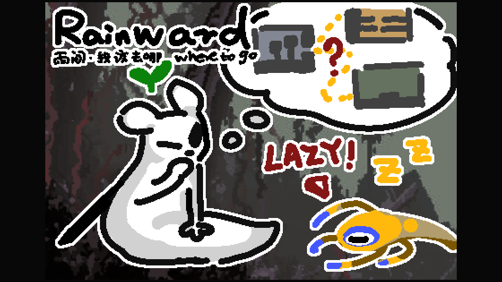

# 雨间：我该去哪 | Rainward: Where to Go

雨间是面向《雨世界》玩家的交互地图与探索指南。它保留原地图的房间、连接、地形、拖拽、缩放和房间交互，并以逐层故事线索提供前进方向。

**[打开网页](https://littlhmw.github.io/rainward/)** · **[GitHub 项目](https://github.com/littlhMW/rainward)** · **[Star 项目](https://github.com/littlhMW/rainward/star)** · **[下载 Mod](https://littlhmw.github.io/rainward/downloads/Rainward-WhereToGo.zip)**

## 地图与探索

- 原版与 Downpour 使用 [Rain World Map](https://rain-world-map.github.io/) 的开源前端，保留真实房间、连接、地形、生物图层、拖拽缩放和房间点击。
- 地图默认按房间遮罩未探索地形，同时保留房间节点和出口连接。导入游戏快照后，已访问房间会显示；每个房间可以单独选择显示、遮罩或跟随游戏记录，也可以一键显示完整区域。
- 地名直接标在地图上。普通区域名默认可见；Wiki 导航模板归入剧透分组的 17 个区域名默认隐藏，可以在设置中开启。房间代码始终可以用于定位。
- 地图支持按房间代码定位，路线和连接在遮罩状态下仍然可见。推荐路线是地图连接与区域方向的参考，实际通行取决于门槛、方向、角色能力和地形 Mod。
- 使用新增或修改地形、房间或连接的 Mod 时，地图与提示可能不准确。本工具不会扫描已安装的 Mod。

## 角色与故事线索

- 支持九位常规剧情角色。基础角色与 Downpour 使用 Rain World Map 前端；Watcher 保留故事线索，并通过原作者网站打开 Watcher 地图。
- 故事线索按层级展开，先提供方向，再提供目的地和路线参考。经过房间或开始会面不会自动完成剧情目标，完成状态由玩家确认。
- 地图工具栏可切换区域指引与房间定位；具体房间目标仅在游戏快照提供有效指引位置时显示，设置默认关闭。
- 网页无需账户。探索记录、单房间遮罩、手动线索进度和旅途笔记保存在当前浏览器中，可在数据面板备份或清除。

## Mod

从上方链接下载压缩包，解压后将 `rainward` 文件夹放入 Rain World 的 `RainWorld_Data/StreamingAssets/mods/`，在 Remix 中启用「雨间：我该去哪 / Rainward: Where to Go」。进入故事游戏，在房间内按住 **G 0.6 秒**，系统默认浏览器会打开当前地点快照；按键和按住时长可以在 Remix 中修改。

快照包含当前区域、房间、游戏实际记录的已访问房间、可读取的剧情状态和玩家位置。Mod 不修改存档、不读取或写入剪贴板，也不会持续追踪位置。网页需要网络连接，打开时才读取快照。

雨甸会显示所有能够读取的玩家位置：同区玩家显示在地图上，跨区玩家提供切换入口；没有精确坐标时只显示房间位置。探索进度只使用房主记录，客机收到的房主周期起点快照可能使本周期的新探索和故事变化延迟。自由模式可以显示玩家位置，但没有可确认的探索与剧情进度。

若链接过长，Mod 会将完整快照写入游戏数据目录的 `Rainward/snapshot.json`，网页可以从数据面板导入，不会截断房间或玩家记录。

## 卸载 Mod

在 Remix 中停用「雨间：我该去哪 / Rainward: Where to Go」并关闭游戏，删除 `RainWorld_Data/StreamingAssets/mods/rainward/` 文件夹即可。若要同时移除按键配置，再删除游戏数据目录中的 `ModConfigs/littlhmw.rainward.txt`；如果曾导出过过长快照，也可以删除 `Rainward/snapshot.json` 及已空的 `Rainward` 文件夹。不要删除其他 Mod 配置或游戏存档。浏览器中的雨间数据可在网页数据面板中清除。

## 数据与隐私

- 原版与 Downpour 的区域数据和地形瓦片按需读取，需要网络；Watcher 地图在原作者网站打开。
- Mod 快照通过网址片段传入，片段不会作为 HTTP 请求路径发送给托管服务器；浏览器历史和分享链接仍可能包含地点、显示名和探索记录。
- 网页没有账户、后台位置服务器、定时上传或自动追踪功能。

## English

Rainward: Where to Go is an interactive *Rain World* map and exploration guide. It preserves the original rooms, connections, terrain, dragging, zooming, and room interaction, then adds layered story clues to help players choose a direction.

- Base-game and Downpour maps use the open-source front end of [Rain World Map](https://rain-world-map.github.io/), including room connections, terrain, creature layers, dragging, zooming, and room controls.
- Unexplored terrain is masked by room by default while nodes and exits remain visible. Import a game snapshot to reveal visited rooms; each room can follow the game record, be shown, or be masked independently, and the entire region can be revealed at once.
- Region names appear on the map. Ordinary names are visible by default; the 17 regions grouped as spoilers in the Wiki navigation template are hidden until enabled. Room codes remain available for precise lookup.
- Room-code lookup, connections, and recommended routes remain available while terrain is masked. The exact-room option is off by default and uses a validated in-game guidance target when available; otherwise the map keeps regional guidance. Routes are references based on connections and regional direction; gates, one-way passages, character abilities, and terrain mods affect actual access.
- Nine standard story campaigns are supported. Clues unfold in layers, suggesting a direction before revealing more detail. Visiting a room or starting a meeting does not complete an objective automatically.
- Watcher keeps its story clues and opens the original author’s map site separately.

Download the mod above, extract `rainward` into `RainWorld_Data/StreamingAssets/mods/`, and enable 「雨间：我该去哪 / Rainward: Where to Go」 in Remix. Hold **G for 0.6 seconds** in a room to open a browser snapshot. The key and hold duration can be changed in Remix.

The snapshot includes the current region and room, visited rooms recorded by the game, available story state, and readable player positions. The mod does not modify saves, read or write the clipboard, or continuously track location. In Rain Meadow, all readable player positions are shown while exploration uses only the host record; clients may receive the host’s cycle-start snapshot later. Free Mode can provide player positions but no confirmed exploration or story progress.

If the URL is too long, the complete snapshot is written to `Rainward/snapshot.json` for import from the data panel. Base-game and Downpour map data and terrain tiles load online; Watcher opens its original map site. Browser progress remains local to the current browser and can be backed up or cleared from the data panel.

To remove the mod, disable 「雨间：我该去哪 / Rainward: Where to Go」 in Remix, close the game, and delete `RainWorld_Data/StreamingAssets/mods/rainward/`. To remove its key configuration, delete `ModConfigs/littlhmw.rainward.txt`; if a long snapshot was exported, delete `Rainward/snapshot.json` and the empty `Rainward` folder. Do not delete other mod settings or save data.

The interface defaults to Simplified Chinese and supports English. Reference material: [Rain World Wiki](https://rainworld.miraheze.org/wiki/Rain_World_Wiki) · [简体中文 Wiki](https://rainworld.miraheze.org/wiki/Rain_World_Wiki/zh-hans) · [Desktop Rain World Slugcat Simulation](https://github.com/littlhMW/desktop-rainworld-slugcat-simulation) · [Original map](https://rain-world-map.github.io/) · [Third-party notices](THIRD-PARTY-NOTICES.md)
